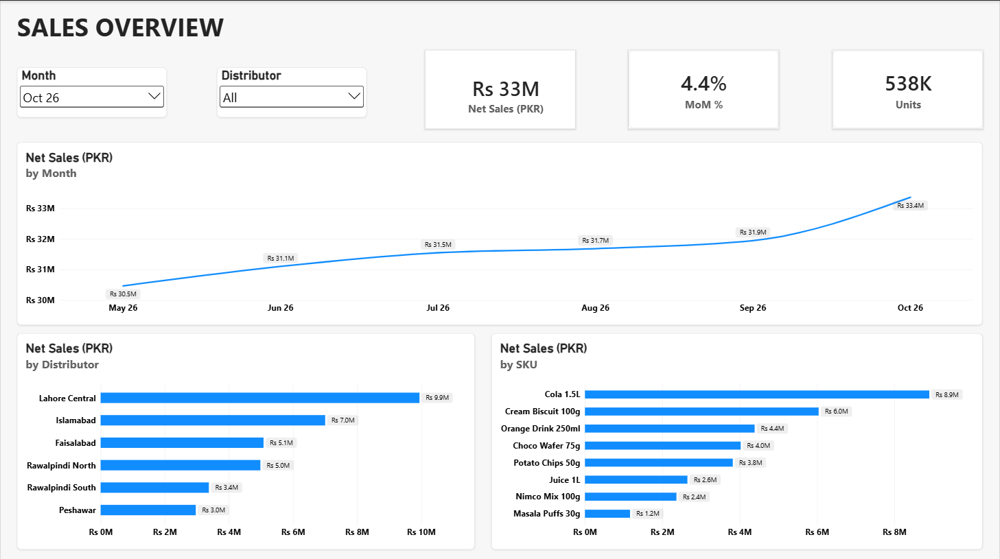
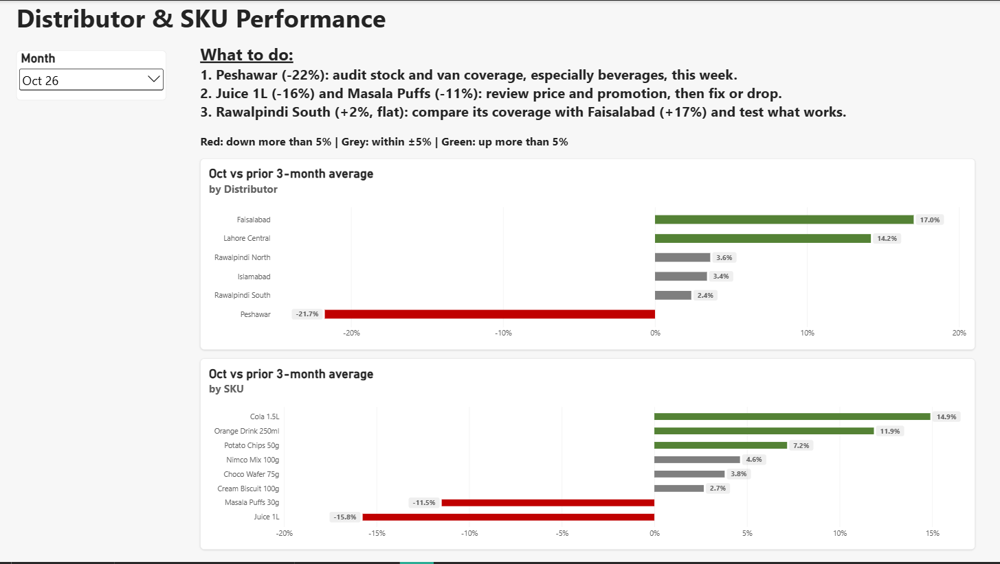
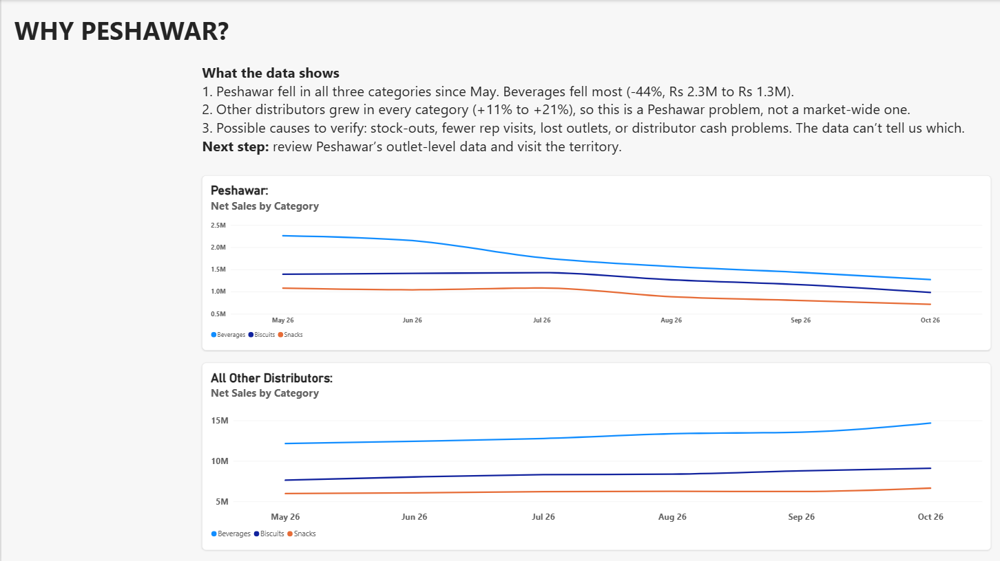

# Sales Performance Dashboard

A Power BI portfolio project exploring sales trends across months, distributors, and products.

## Preview

### Sales overview

### Distributor and SKU performance

### Peshawar deep dive

## What it highlights

- Monthly net sales, month-over-month change, and units sold
- Sales comparisons by distributor and SKU
- Performance against the prior three-month average
- A focused view of Peshawar’s declining sales and follow-up questions for investigation

## Tools

- Microsoft Power BI

## Files

This showcase contains static dashboard screenshots. The Power BI project file and Excel workbook are kept out of this preview package.
